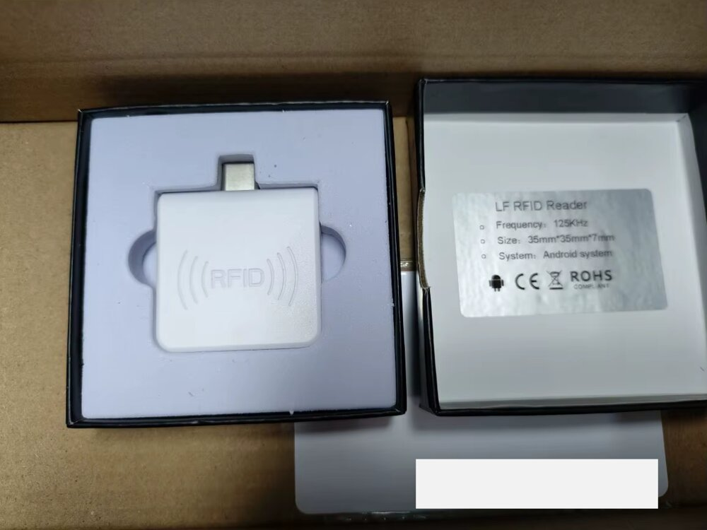
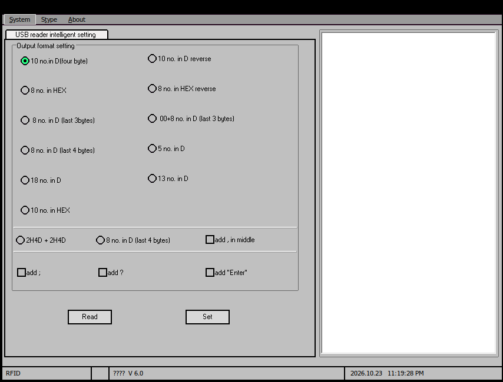

# USB RFID reader (ffff:0035, "ARM CM0 USB HID Keyboard") – Linux configuration tool

Configure the output format of the cheap **white USB-C 125 kHz RFID / EM4100 ID card reader**
(keyboard emulation, "plug and play") **on Linux** – no Windows, no Wine needed.

This is an open-source replacement for the Chinese Windows setup program
`0012752907.exe` + `usb.dll` ("RFID" window, tab **"USB reader intelligent setting"**,
status bar `V 6.0`). The protocol was reverse-engineered from that program and tested on real hardware.



*Sold as "LF RFID Reader – Frequency: 125KHz – Size: 35mm\*35mm\*7mm – System: Android system",
white square USB-C dongle with an "((RFID))" logo.*

**Matches your reader if `lsusb` shows:**

```
ID ffff:0035 ARM CM0 USB HID Keyboard
```

Kernel log: `hid-generic 0003:FFFF:0035...: input,hidraw: USB HID v1.10 Keyboard [ARM CM0 USB HID Keyboard]`
and `usbhid 1-x:1.1: couldn't find an input interrupt endpoint` – that second interface is the config interface.

With this tool you can choose what the reader types when a card is scanned: 10-digit decimal
(factory default), 8-digit decimal, hex, reversed byte order, Wiegand-style `2H4D+2H4D`, and
whether it adds **Enter**, `;`, `?` or `,`.

## The original Windows interface



Every option on this screen maps to a format code in `rfidcfg.py`:

| Windows option | Code | Output |
|---|---|---|
| 10 no. in D (four byte) | `0F` | 10 decimal digits – **factory default** |
| 8 no. in HEX | `0C` | 8 hex digits |
| 8 no. in D (last 3bytes) | `0B` | 8 decimal digits from the last 3 bytes |
| 8 no. in D (last 4 bytes) – left column | `09` | 8 decimal digits from the last 4 bytes |
| 18 no. in D | `06` | 18 decimal digits |
| 10 no. in HEX | `07` | 10 hex digits (full EM4100 ID) |
| 10 no. in D reverse | `0A` | 10 decimal digits, reversed byte order |
| 8 no. in HEX reverse | `03` | 8 hex digits, reversed byte order |
| 00+8 no. in D (last 3 bytes) | `0D` | `00` + 8 decimal digits |
| 5 no. in D | `08` | 5 decimal digits |
| 13 no. in D | `05` | 13 decimal digits |
| 2H4D + 2H4D | `00` | 2 hex + 4 decimal, twice |
| 8 no. in D (last 4 bytes) – bottom row | `0E` | 8 decimal digits from the last 4 bytes (variant) |
| add "Enter" | `--enter 1` | Enter after the number |
| add ; | `--semicolon 1` | semicolon |
| add ? | `--qmark 1` | question mark |
| add , in middle | `--comma 1` | comma in the middle |
| **Read** / **Set** buttons | `read` / `set` | |

## Install

```sh
sudo apt install python3-usb          # Debian/Ubuntu (pip: pyusb)
git clone https://github.com/nonitex/usb-rfid-reader-ffff-0035-linux.git
cd usb-rfid-reader-ffff-0035-linux
sudo install -m 644 70-rfid-reader.rules /etc/udev/rules.d/
sudo udevadm control --reload
# unplug and replug the reader
```

The udev rule gives the logged-in user access to the reader, so no `sudo` is needed afterwards.
Without it, run the tool as root.

## Usage

```
$ ./rfidcfg.py read
Output format: 0F  10 decimal digits (4 bytes) - factory default
Semicolon:     no
Question mark: no
Comma:         no
Enter:         yes

$ ./rfidcfg.py set 07 --enter 1        # 10 hex digits + Enter
Set up success.

$ ./rfidcfg.py set 0F --enter 1        # back to factory default
$ ./rfidcfg.py formats                 # list all codes
$ ./rfidcfg.py -v read                 # also print raw frames
```

Settings are stored in the reader, so it keeps them on any computer (Linux, Windows, macOS, Android).

## Protocol

The device has two HID interfaces:

| Interface | Class | Purpose |
|---|---|---|
| 0 | HID boot keyboard, EP 0x81 IN | types the card number |
| 1 | HID, **no endpoints** | configuration via feature reports on EP0 |

Linux `usbhid` refuses interface 1 ("couldn't find an input interrupt endpoint"), so there is no
`/dev/hidraw` for it; the tool talks to it with libusb control transfers.

- **Write:** `SET_REPORT` (feature, report ID 1, wIndex 1), 256 bytes:
  `01 00 00 00 | 00 00 | len (u16 LE) | frame | zero padding`
- **Read back:** `GET_REPORT` (feature, report ID 2, wIndex 1), 256 bytes; the response frame starts at offset 8.
- **Frame:** `AA <addr=00> <len> <data…> <BCC> BB`, where BCC = XOR of addr, len and data.

| Command | Data | Response |
|---|---|---|
| Read config | `83` | `AA 00 12 <status> 00 <fmt> <;> <?> <,> <enter> … BCC BB` |
| Write config | `82 <fmt> <;> <?> <,> <enter> 00 00 00` | `AA 00 02 00 80 82 BB` (status `00` = OK) |

Example: read the factory default →
`aa 00 12 00 00 0f 00 00 00 01 01 00 00 00 00 00 00 00 00 00 00 1d bb`

## Original Windows software

The vendor's original setup tool is included in [`windows/`](windows/) for reference
(keep both files in the same folder; also runs under Wine, as in the screenshot above):

| File | SHA-256 |
|---|---|
| `windows/0012752907.exe` | `d4384ec546f626cb5a29a7191f4abd9b54464f68ea991a3b0adf8ab0f617de17` |
| `windows/usb.dll` (`generalHID.dll`) | `c5337e5ccf6be08a1ee64d7b2e04b95963211c69eee442e2081b696b38bb2b83` |

These binaries are the manufacturer's freeware, redistributed unmodified and not covered by the MIT license.

The hidden tabs of the Windows program (Mifare S50/S70, Ultralight, ISO14443B, ISO15693, LED/buzzer
control) belong to other reader models and are not implemented here.

## Keywords

USB RFID reader Linux, 125kHz EM4100 ID card reader configuration, RFID reader output format,
change RFID reader to hex / decimal, remove Enter, ffff:0035, VID 0xFFFF PID 0x0035,
ARM CM0 USB HID Keyboard, USB reader intelligent setting, 0012752907.exe, RFID reader setup software,
USB-C RFID reader, LF RFID Reader 125KHz 35mm*35mm*7mm Android, USB Type-C RFID dongle for phone, keyboard wedge RFID reader, pyusb HID feature report.

## License

MIT
